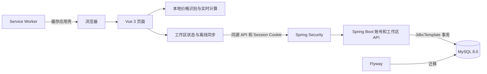

# 应用架构

Vue 在浏览器内匹配粘贴数据、维护当前未保存草稿、计算单行与合计，并使用 CSS 生成打印布局。Spring Boot 管理账号、品牌库、标签和每用户一份计算快照。浏览器通过同源 API 读写 MySQL，后端以 Spring Security 会话确认账号。新注册账号独立复制预置品牌，之后可自由增删改。

品牌使用 UUID。品牌库文本保存时，同名品牌按出现顺序沿用原有 ID 和标签，重排行可保留临时覆盖值及快照；改名按删除旧记录并新增处理。品牌库按版本号写入，另一个窗口已更新时返回冲突。旧品牌删除时，外键级联清理标签关联及快照明细。备份导入在单个事务内替换品牌库和快照。

构建版的 Service Worker 仅缓存应用壳。浏览器保存当前账号最近一次可用的工作区副本，用于断网重开页面、计算和记录待同步的修改。「连接并同步」确认会话之后上传，遇到品牌库版本冲突时可导出当前 JSON，或放弃离线改动并加载服务器数据。退出会移除本机工作区副本，离线退出会标记会话，恢复网络后先向服务器补发退出请求。

开发时 Vite 代理 API。构建时 Vite 输出静态文件和按内容生成版本的 Service Worker，Maven 将这些文件打进 JAR。会话由单个 Spring Boot 进程维护，重启应用后需要重新登录，品牌库与快照仍保存在 MySQL。
