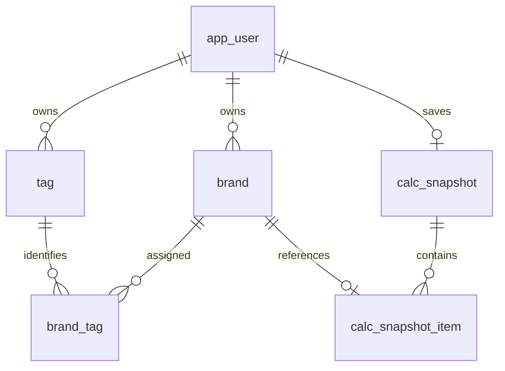

# MySQL 数据字典

业务表使用 InnoDB。字符数据默认使用 `utf8mb4_0900_bin`，品牌 ID 和用户名使用 ASCII。由 [V1 Flyway 迁移](../../backend/src/main/resources/db/migration/V1__workspace.sql) 建表，[V2 迁移](../../backend/src/main/resources/db/migration/V2__account_roles.sql) 为账号增加角色。Flyway 另有自己的 `flyway_schema_history` 表。

V3、V4 建立共享目录。线上读写使用 `shared_catalog`（统一版本）、`shared_brand`、`shared_tag` 和 `shared_brand_tag`。每个账号的计算明细写入 `user_calculation_item`，由账号快照和共享品牌外键约束。迁移优先采用已维护的管理员目录，按 UUID 或唯一同名品规关联旧快照。下文的 V1、V2 表和 SQL 示例记录历史结构。

## SQL 脚本

| 文件 | 用途 |
| --- | --- |
| [00-create-database.sql](00-create-database.sql) | 由 MySQL 管理员创建 `calc_qc` 库及默认字符集。可重复执行。 |
| [01-create-tables.sql](01-create-tables.sql) | 六张业务表的 DDL，包含 V1、V2 的最终表结构，适用于查阅和独立 SQL 演练。通过应用启动时，Flyway 自动建表并记录版本。 |
| [02-seed-default-brands.sql](02-seed-default-brands.sql) | 给已存在且品牌库为空的应用账号写入全部 44 条预置品牌。脚本在事务中锁定目标用户，已有品牌时插入 0 条。 |

应用注册会自动初始化品牌库。需要手工补种时，在 MySQL 客户端执行以下命令。

```sql
USE calc_qc;
SET @calc_qc_seed_username = 'your_username';
SOURCE docs/database/02-seed-default-brands.sql;
```

种子来源为 [default-brands.json](../data/default-brands.json)。品牌别名由前端使用，数据文件见 [brand-aliases.json](../data/brand-aliases.json)。

## 表关系



| 表 | 字段 | 含义 |
| --- | --- | --- |
| `app_user` | `id` BIGINT PK | 内部账号 ID，自增 |
| | `username` VARCHAR(32) UNIQUE | 英文字母、数字或 `._-`，保存前转小写 |
| | `account_role` ENUM | 商户 MERCHANT、客户经理 ACCOUNT_MANAGER、管理员 ADMIN，默认 MERCHANT |
| | `password_hash` VARCHAR(100) | BCrypt 密码哈希 |
| | `catalog_revision` BIGINT | 品牌库版本，从 0 开始，每次保存递增 |
| | `created_at` TIMESTAMP(6) | 注册时间 |
| `brand` | `user_id` BIGINT, `id` CHAR(36) | 账号与 UUID 组成主键，账号为外键 |
| | `name` VARCHAR(120) | 品牌名，可以同名 |
| | `wholesale` DECIMAL(15,6) | 大于零的预设批发价，元/条 |
| | `market` DECIMAL(15,6) NULL | 可选的预设市场价，元/条 |
| | `sort_order` INT | 在账号品牌库中的显示顺序，从 0 开始 |
| `tag` | `user_id` BIGINT, `name` VARCHAR(12) | 账号与标签名组成主键，账号为外键 |
| | `sort_order` INT | 标签显示顺序 |
| `brand_tag` | `user_id`, `brand_id`, `tag_name` | 三列组成主键，并以含账号的复合外键关联品牌和标签 |
| | `sort_order` INT | 品牌上各标签的显示顺序 |
| `calc_snapshot` | `user_id` BIGINT PK/FK | 每账号一份计算快照 |
| | `saved_at` TIMESTAMP(6) | 最近一次服务端快照写入时间 |
| `calc_snapshot_item` | `user_id` BIGINT, `brand_id` CHAR(36) | 复合主键，关联同账号的快照及品牌 |
| | `wholesale_override`, `market_override` VARCHAR(32) NULL | 草稿价格文本。`NULL` 沿用预设，空字符串表示输入框被清空 |
| | `quantity` VARCHAR(16) NULL | 草稿数量文本。`NULL` 默认 1，空字符串表示输入框被清空 |
| | `is_hidden` BOOLEAN | 是否在计算器内移除该行 |

## 旧版存储与模型对照

| 旧字段或内存状态 | 新位置 |
| --- | --- |
| `cigarette_calc_data_v3.brands[]` 的 `name`、`wholesale`、可选 `market` | `brand`，数组下标转换为排序，新增稳定 UUID |
| `cigarette_calc_data_v3.tags[]` | `tag` |
| `cigarette_calc_data_v3.brandTags` 的品牌下标及标签列表 | `brand_tag`，导入时按对应下标找到新 UUID |
| `cigarette_calc_data_v3.records[]` | 旧版预留的使用记录。当前旧版 UI 无写入入口，仓库无记录样例。旧代码的 `addRecord(result)` 将任意对象和毫秒级 `time` 放入数组 |
| `cigarette_calc_data_v3.updatedAt` | 旧版浏览器写入时间。品牌库并发校验改用 `catalog_revision` |
| `cigarette_calc_defaults_loaded` | 旧版首次初始化标记。注册事务直接创建初始品牌，无单独标记 |
| `cigarette_calc_snapshot_v1.savedAt` 和 `items[]` | `calc_snapshot` 及明细。旧明细含 `name`、`wholesale`、`market`、`qty`、`hidden` |
| 内存中的 `wholesaleOverride`、`marketOverride`、`qtyCache`、`hiddenPresets` | Vue 的 UUID 草稿。点「保存」后写入快照 |
| `currentFilterTag`、`openTag`、`tagSearch`、`brandNameToIndex` | 页面状态及可重建索引 |
| `exportJSON()` 生成的版本 3 备份 | 旧格式含 `version`、`exportedAt`、`brands`、`records`。新导入器兼容其品牌数据 |
